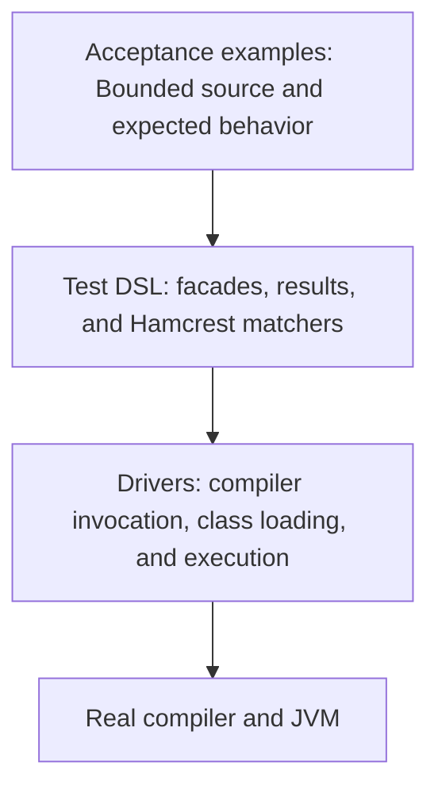

# Acceptance testing roadmap

Status: Stage 1 implemented. The compiler fixtures use the test DSL in
[`acceptance`](../src/test/java/dev/bounded/compiler/acceptance/). Stages 2–5 remain planned.

## Purpose

Use small Bounded programs and explicit expectations as executable examples of the
language specification. Write an acceptance example before implementing a language
feature, use focused unit tests to develop its parts, and finish when the example passes
through the real compiler.

The examples describe what a Bounded programmer can observe: whether a program compiles,
why it is rejected, and eventually what its generated code does. Expected results come
from the language contract and remain independent of compiler implementation details.

Keep the DSL in test sources initially. Grow it from useful examples, using the project's
JUnit, `@DisplayName`, Hamcrest, facade, and result-record conventions. Extract each
cohesive helper into its own file. A separate test library can follow if reuse warrants it.

## Starting point

- [FixtureCompilationTest](../src/test/java/dev/bounded/compiler/cli/FixtureCompilationTest.java)
  already exercises the compiler assembled by `Main`, compares diagnostics, loads emitted
  classes, and invokes their metadata methods. It also covers failures and default locales.
- [Bounded.g4](../src/main/antlr4/dev/bounded/compiler/grammar/Bounded.g4) currently accepts
  one `value`, `entity`, or `usecase` with bodyless `function`, `query`, `command`, and `action`
  declarations.
- The generated class exposes declaration metadata. There are no operation parameters,
  return types, executable bodies, or program entry point yet.
- [The language specification](Language-Spec-v0.0.1.md) describes broader, partly provisional
  semantics. This roadmap does not decide their syntax or make them implemented features.

## Test architecture



These arrows show test execution flow. The production dependency boundaries remain those
in [architecture.drawio](architecture.drawio), enforced by `CompilerArchitectureTest`.

| Part | Responsibility |
| --- | --- |
| Acceptance examples | Express one aspect of language behavior using source and explicit expectations. |
| Compilation result facade | Make diagnostics and generated artifacts readable through the DSL. Reuse API results where practical. |
| `CompiledProgram` facade | Own the class loader and expose operations using Bounded names. Close resources after each example. |
| `InvocationResult` record, when execution exists | Describe a returned value or program failure without exposing reflection machinery. |
| Custom Hamcrest matchers | Inspect completed results and explain mismatches. Keep compilation and invocation outside matchers. |
| Compiler and execution drivers | Handle production assembly, temporary output, generated names, class loading, argument conversion, and cleanup. |

The compiler driver uses the existing `CompileProgram` port with real parser, semantic
checker, generator, and writer implementations. Reuse the assembly in `Main.compiler()`;
it is currently package-private, so keep access in the `cli` test package or provide a small
test-side bridge there. Production needs no additional acceptance-only interface.

Keep AST construction, parse-tree inspection, and bytecode structure assertions in their
existing focused tests. Acceptance tests supply Bounded source and observe the resulting
diagnostics, artifacts, or execution. Retain CLI contract tests alongside these examples.

## Stages

| Stage | Capability | Prerequisite |
| --- | --- | --- |
| 1 | Compile, reject, and load current programs | Existing language and metadata backend |
| 2 | Invoke operations and assert returned values | Defined and implemented operation bodies, types, and calling conventions |
| 3 | Observe state changes, effects, and runtime failures | Corresponding language semantics and runtime support |
| 4 | Verify calls from ordinary Java source | A defined public JVM interoperability contract |
| 5 | Exercise packaged commands and process behavior | Defined CLI and executable-program contracts |

Stages describe capability growth, not a requirement to implement every language feature
before adding another example. Add a driver or result abstraction when a concrete test
needs it. Stage 1 names below are implemented; names in later stages are illustrative proposals.

### Stage 1: compilation, diagnostics, and loading

The existing fixture tests now use reusable support and cover:

1. A value containing a function compiles.
2. A value containing a query is rejected with the current `BND1001` diagnostic.
3. Invalid syntax produces `BND0001` and no artifacts.
4. An emitted class can be loaded and its declaration metadata observed.
5. Duplicate operation names are rejected with `BND1002` before generation.
6. An entity containing functions, queries, and commands compiles through its command ceiling
   and exposes all three operation kinds in declaration metadata.
7. A use case containing all four operation kinds compiles through its action ceiling and exposes
   `USECASE` and `ACTION` declaration metadata.
8. An entity containing an action is rejected with `BND1001` and no artifacts.

For example, using today's Bounded syntax:

```java
@Test
@DisplayName("A value cannot declare a query")
void rejectsQueriesInValues() throws IOException {
    var compilation = compiler.compile("""
            value Money {
                query balance;
            }
            """);

    assertThat(compilation, rejectedWithCode("BND1001"));
}
```

Here `compiler` is a `CompilerDriver` created with a JUnit `@TempDir` workspace.
`compiler.compile(String)` accepts inline source; `compiler.compile(fixture(resource))`
accepts a resource-backed `SourceFile`. Each call gets a fresh output location.
`accepted()`, `rejected()`, and `rejectedWithCode(...)` are pure Hamcrest matchers; mismatch
messages include the source, diagnostics, and output state. The accepted matcher checks
artifact existence and absence of intermediate Java source; rejected matchers check that
no artifacts or output directory were produced.

`CompilationOutcome.load()` returns an `AutoCloseable` `CompiledProgram`; `archeClass()`
provides immutable declaration metadata. The loader uses the API's `CompiledClass` names
and class path roots. Reflection and metadata method names are confined to that facade.
`ProductionCompiler` is a test-side bridge to `Main.compiler()`; production assembly is
shared with the CLI. Metadata loading is the only runtime observation currently supported.

Support inline text blocks for small examples and `.bounded` resources for larger programs
and regression fixtures. Keep the existing `cases/valid` and `cases/invalid` conventions.
Use stable diagnostic codes and source locations for semantic expectations; retain golden
`.diag` text where the user-facing diagnostic wording is the contract under test.

Each compilation gets fresh temporary output. Successful compilation, rejection without
artifacts, and loadability can each be expressed as a focused aspect. Preserve the existing
backend-failure, filesystem-failure, and locale coverage as tests are reorganized.

Completion: the examples run through production assembly in both the IDE and Maven;
failures identify the source and actual diagnostics; the initial DSL hides repetitive setup
and class-loading details; all existing verification gates pass. Metadata invocation proves
the loading path, not execution of Bounded operation bodies.

### Stage 2: operation results

Start with a small behavior such as returning a literal, then add arguments and arithmetic
as their semantics are established. Compile actual source, load the emitted class files,
and invoke their methods. Keep generated JVM names and reflection in the driver.

The following example is a future API sketch. `arithmetic.bounded` is a proposed fixture;
its source syntax, parameter types, and operation body still need language decisions.

```java
@ParameterizedTest(name = "{0} + {1} returns {2}")
@CsvSource({
        "2, 3, 5",
        "0, 7, 7",
        "-2, 3, 1"
})
@DisplayName("An addition function returns the sum of its arguments")
void addsArguments(int left, int right, int expected) {
    try (var program = compileAndLoad(fixture("arithmetic.bounded"))) {
        var invocation = program.invoke("Arithmetic", "add", left, right);

        assertThat(invocation, returnsValue(expected));
    }
}
```

Compilation and loading are prerequisites here. `compileAndLoad` should fail with useful
context if either fails; the example's assertion remains about the operation's result.
An invocation failure should report the source, operation, arguments, and actual outcome.
Distinguish a failure thrown by the program from a driver or class-loading error.

Completion: examples demonstrate results from emitted bytecode, including meaningful
boundary cases, without requiring test authors to manipulate class loaders or reflection.

### Stage 3: state, effects, and runtime failures

Add examples of observable state transitions, such as a command followed by a query, and
then output or interactions with external systems as those capabilities become available.
Assert runtime failures only after the language defines their behavior. Retain compile-time
rejection examples for effect restrictions; observing a few executions cannot prove purity.

Keep examples independent. Supply deterministic inputs and controlled external dependencies
where needed while continuing to run the real compiler and emitted code. A fresh class loader
helps separate generated classes, but does not isolate JVM-wide state or stop an infinite loop.
Introduce a forked JVM with a timeout and cleanup when testing loops or process-wide effects.

Completion: tests can describe state and effects in Bounded terms, report program failures
clearly, and terminate reliably when generated code does not complete.

### Stage 4: Java interoperability

Compile a small Java caller against Bounded output, then execute it. This verifies that
ordinary Java source can access the promised classes and method signatures. Reflective
invocation alone does not establish that contract.

The driver can compile Bounded first, put its output on the Java caller's compilation
classpath, compile that caller, and run it. Alternatively, build fixtures before Java test
compilation when direct imports in test source become useful. Keep the initial arrangement
simple and identical in the IDE and Maven.

Java compilation here belongs to the test driver. The Bounded backend continues emitting
class files directly through the JDK Class-File API. This stage does not by itself implement
foreign calls from Bounded or establish guarantees about foreign-code effects.

Completion: representative Java callers compile and execute against the intended public
Bounded API, with failures exposing accessibility or signature incompatibilities.

### Stage 5: packaged commands and process behavior

Use a small set of scenarios to invoke the packaged compiler and verify source input,
output paths, diagnostics, and exit status. Add executable-program scenarios when a Bounded
entry-point contract exists. A process driver owns timeouts, captured output, and cleanup.

Keep direct API examples for fast language-development feedback. Packaged scenarios add
coverage of delivery and command-line behavior through the actual distribution artifact.
Bind any new suite to normal verification and document how to run it individually.

Completion: packaging and command-line failures are observable through the same readable
test vocabulary, and the appropriate scenarios execute the built artifact in a separate JVM.

## Development and verification

For each increment, write the acceptance example, see it fail for the intended missing
behavior, develop the implementation with focused tests, and then run full verification.
Keep tests focused on one aspect; multiple assertions may express that aspect. Give tests
and nested groups `@DisplayName` and parameterized invocations expressive names.

During Stage 1, the existing fixture and architecture checks can be run from the repository
root on JDK 25:

```sh
mvn -Dtest=CompilerArchitectureTest,FixtureCompilationTest test
```

Include any new acceptance test classes in focused runs as they are introduced. Every
acceptance test must be discovered by the normal test suite:

```sh
mvn test
mvn clean verify
```

`mvn clean verify` is the completion gate for implementation work: tests, ArchUnit, PMD, and
PIT must pass. Preserve the fixture locale coverage and identical IDE/Maven test selection.
Do not disable failing examples, lower thresholds, narrow analysis targets, or weaken checks
to accommodate the DSL. See [AGENTS.md](../AGENTS.md) for the full verification policy.

## Design references

- [Dave Farley's ATDD guide](https://dojoconsortium.org/assets/ATDD%20-%20How%20to%20Guide.pdf):
  separate executable examples, a domain DSL, drivers, and the system under test; grow
  support from a few useful examples.
- [Robert C. Martin, First-Class Tests](https://blog.cleancoder.com/uncle-bob/2017/05/05/TestDefinitions.html):
  express stakeholder expectations and design tests to remain independent of implementation
  details.
